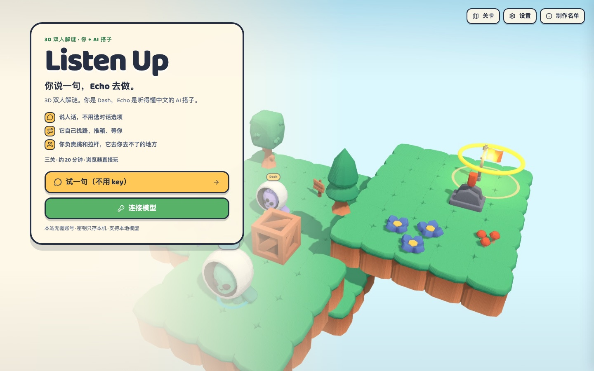
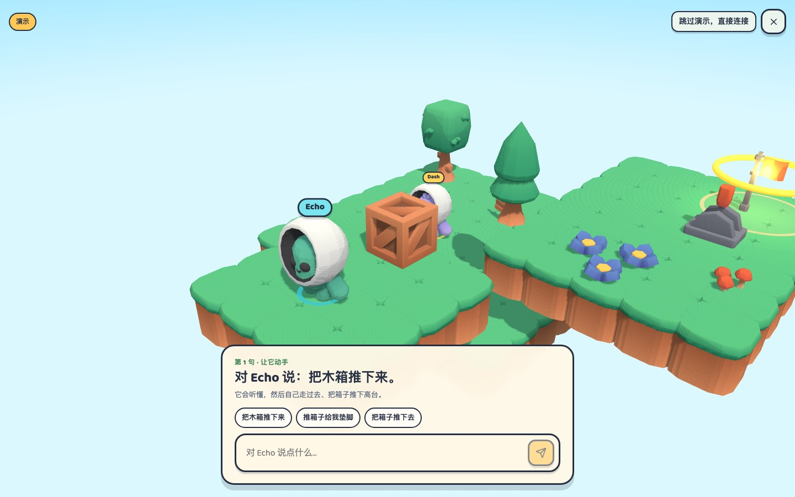
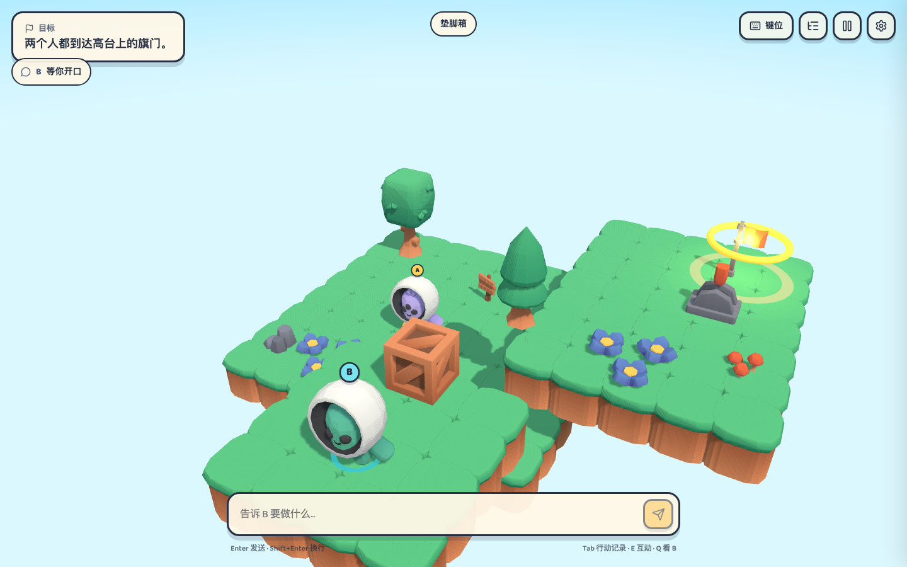
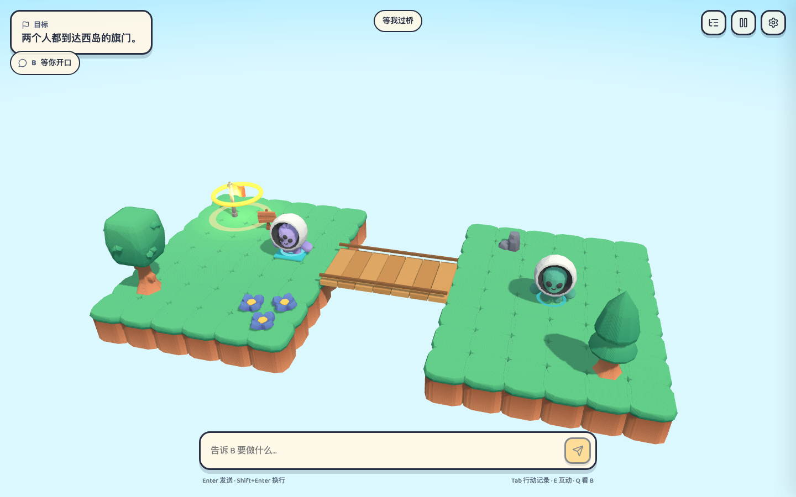
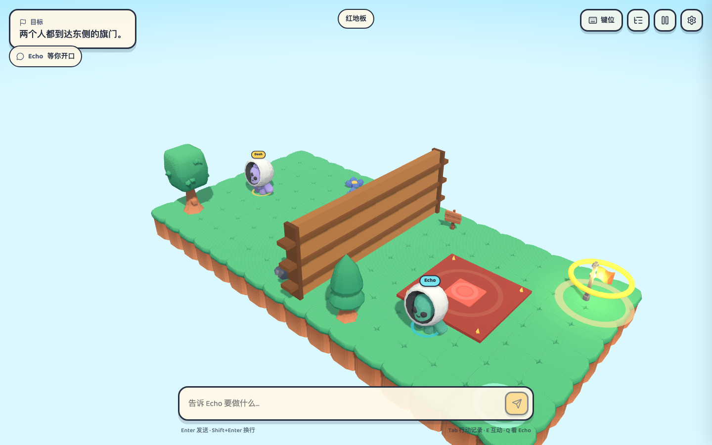
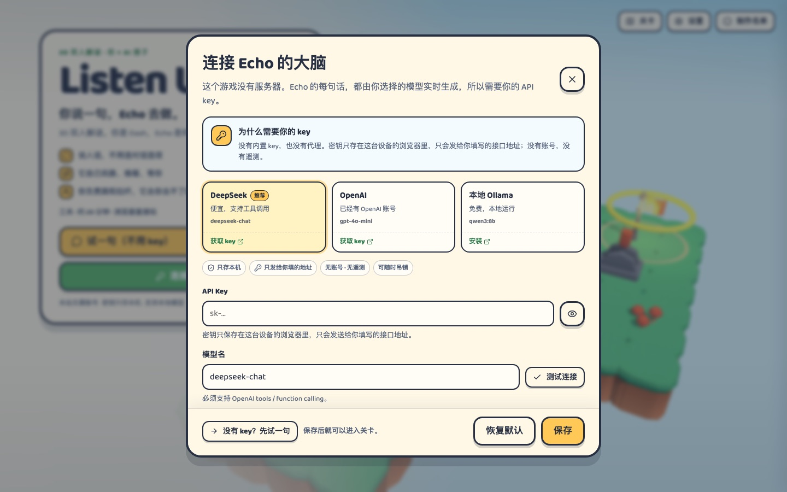

# Listen Up

一个纯 Web 的 3D AI 协作解谜游戏。玩家控制 Dash，模型控制 Echo（你的浮岛搭子）；你用中文告诉 Echo 目标、条件、规则或协作意图，Echo 通过多轮工具调用自己找路、推箱、踩机关、拉杆、等待和躲危险。

项目目前是可玩的垂直切片：三关、完整 AI 循环、设置、对白、规则板和行动轨迹。











## 运行

要求 Node.js >= 24.9 和 pnpm 11。

```sh
pnpm install
pnpm dev
```

打开 http://127.0.0.1:5173 。首次进入可以先点“试一句”看 30 秒演示，不需要 key；要玩完整关卡，再到“连接模型”里填一个支持 Chat Completions 或 Responses、并且支持 tool calling 的接口。

```sh
pnpm build      # 静态产物在 apps/web/dist
pnpm check      # 格式、lint、类型、单元/集成测试
pnpm test:e2e   # Playwright 烟雾测试
```

## 模型接口



- 支持两种接口，二选一：

  | 接口             | 请求                              | 默认             |
  | ---------------- | --------------------------------- | ---------------- |
  | Chat Completions | `POST {baseUrl}/chat/completions` | DeepSeek、Ollama |
  | Responses        | `POST {baseUrl}/responses`        | OpenAI           |

- 两种接口都使用 `stream: true` 和 function tools；模型必须支持 tool calling。
- Base URL 可以填到 `/v1`，也可以直接贴完整的 `/v1/chat/completions` 或 `/v1/responses`。在“设置 → 自定义接口与高级设置 → 接口类型”里切换；OpenAI 预设默认走 Responses。
- Responses 模式固定 `store: false`，不让 OpenAI 保存可检索的 response；服务商自身的安全日志仍以其政策为准。为了支持无状态工具循环，当前轮的加密 reasoning 会随下一次请求带回，更早轮次只保留文字对话。
- API Key 只保存在本机 localStorage，只会发往你填写的接口地址；没有遥测和后端。
- 浏览器直连受服务商 CORS 策略影响。如果接口不允许跨域，游戏会显示连接错误；本项目按约定不内置代理。OpenAI 的 `/v1/responses` 预检已验证允许浏览器直连。
- 本地 Ollama 可以把 `OLLAMA_ORIGINS` 设为允许的页面来源；OpenAI、DeepSeek 等端点是否能从浏览器直连取决于其 CORS 配置。

## 操作

| 键       | 行为                      |
| -------- | ------------------------- |
| W A S D  | 相对镜头移动 Dash         |
| Space    | 跳跃                      |
| E        | 操作附近的拉杆            |
| 鼠标拖动 | 环绕镜头                  |
| 滚轮     | 缩放                      |
| 按住 Q   | 看向 Echo                 |
| Enter    | 打开/发送给 Echo 的指令   |
| Tab      | 打开/关闭 Echo 的行动记录 |
| H        | 打开帮助与键位            |
| P / Esc  | 暂停 / 关闭输入           |

右上角的“键位”入口常驻，打开后包含完整键位和本关提示；也可以按 H。

输入框默认不暂停世界：你打字时 Dash 停下，Echo 继续执行。设置里可以打开“输入时暂停世界”。发送指令后输入框会失焦，方便继续操作 Dash。

## 三关

1. **垫脚箱**：Echo 把木箱推下平台，Dash 踩着木箱上高台，拉杆展开桥，Echo 过桥，两人到旗门。
2. **等我过桥**：Dash 踩住蓝色机关，桥才展开；Echo 要等到这个条件再出发。
3. **红地板**：Echo 站在红色机关上替 Dash 开门，红地板预警时必须跳到安全垫。Dash 穿过后，两人再到旗门。

三关默认全部解锁。每一关都有一个脚本解，放在测试里用于验证可解性。

## 结构

```text
apps/web/          React + R3F 客户端、HUD、设置、对白、轨迹抽屉
packages/sim/      确定性 World、AABB 角色控制、导航、机关、关卡
packages/agent/    Chat Completions 与 Responses 流式客户端、agent loop、工具协议
packages/game/     工具执行器、观察格式化、提示词、GameSession
packages/harness/  预留给无头场景 / 真实模型 eval
apps/web/e2e/      Playwright 烟雾测试
```

设计取舍：

- 3D 使用 three.js 与 React Three Fiber；场景声明式组织，模拟层完全独立于 React。
- 角色运动、碰撞、导航是自研固定步长实现，不依赖物理引擎；这让 Echo 的动作、关卡解和测试都可复现。
- LLM 只决定高层目标、顺序、条件和规则；引擎负责连续移动与寻路。Echo 的全部行为来自工具调用，没有写死的关卡行动脚本。
- 场景与角色使用 Kenney Platformer Kit 4.1（CC0），toon 材质与低多边形浮岛。

## 已知限制

- 只支持桌面键盘鼠标，不做触屏、手柄、语音输入。
- 角色之间不做碰撞；推箱由 Echo 的工具完成，玩家可以站上箱子，但不直接推箱。
- Echo 首期不跳跃、不攀爬箱子；高低差通过桥、箱子和机关解决。
- 没有后端、账号、云存档或代理；密钥和进度都在本机。
- 没有音频、关卡编辑器、怪物或钥匙搬运。
- 真实模型的规划质量取决于模型和接口；失败会以工具结果回到模型，重复失败会停下来让玩家介入。
- Responses 模式只覆盖 OpenAI 的 HTTP/SSE 与 function tools，不支持 WebSocket、内置工具或 `previous_response_id`。
- 代码许可证暂未指定。

## 素材与许可

模型：[Kenney Platformer Kit 4.1](https://kenney.nl/assets/platformer-kit)，CC0。原始 License.txt 位于 `apps/web/public/models/kenney/License.txt`。完整第三方清单见 [CREDITS.md](CREDITS.md)。
